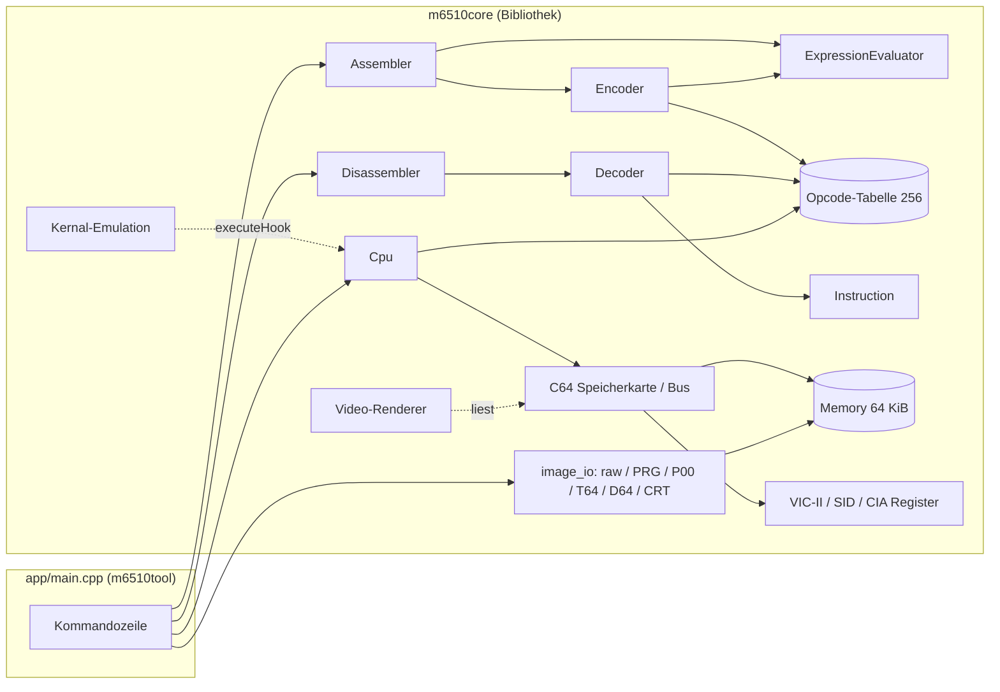

# Architektur

> Die Struktur entspricht den Schwesterprojekten [Z80](https://github.com/PhotonPower/Z80) und
> [MC68000](https://github.com/PhotonPower/MC68000). **Stand 0.2:** umgesetzt sind die Grundbausteine, Opcode-Tabelle,
> Dekoder, Ausdrucksauswerter, Encoder, Assembler, Disassembler, PETSCII/BASIC und PRG/P00 (Spalte „Stand“).

## Überblick

Die Bibliothek `m6510core` hat **keine** Konsolenausgabe und keinen globalen Zustand; alle Klassen sind unabhängige
Instanzen. `app/main.cpp` ist die einzige Stelle mit Ein-/Ausgabe auf Stdin/Stdout und mit Dateinamen. Monitor und
Agenten-Schnittstelle sind weitere Frontends derselben Bibliothek.

## Komponenten

| Header (`include/m6510/`)   | Aufgabe                                                                                 | Stand    |
|-----------------------------|-----------------------------------------------------------------------------------------|----------|
| `types.hpp`, `version.hpp`  | `Byte`/`Word`/`Address`, Vektoren, Prozessorport, Flag-Bits, Version                    | fertig   |
| `format.hpp`                | Zahlenformatierung (`$1F`, `0x1F`, `1FH`)                                               | fertig   |
| `memory.hpp`                | `Memory`: flacher 64-KiB-Speicher, Little-Endian, `read16Wrapped`                       | fertig   |
| `opcodes.hpp`               | die Tabelle der 256 Opcodes: Mnemonic, Adressierungsart, Länge, Zyklen, Klasse          | fertig   |
| `instruction.hpp`           | `Instruction`: Adresse, Bytes, Mnemonic, Operand, `FlowKind`, Ziel                      | fertig   |
| `decoder.hpp`               | `decode(memory, address, options)` → ein `Instruction`; Symbolizer                      | fertig   |
| `expression.hpp`            | Ausdrucksauswerter (`<`, `>`, `*`, Symbole, Hex-Standard für den Monitor)               | fertig   |
| `encoder.hpp`               | `encodeInstruction(request, value)` → Bytes; Operanden-Parser                           | fertig   |
| `assembler.hpp`             | Zeilenparser, Symboltabelle, Mehrpass (Zero Page / absolut), `AssemblyResult`           | fertig   |
| `disassembler.hpp`          | Ablaufanalyse, Querverweise, Kommentare, Symboldateien, KERNAL-Namen, Ausgabe (`render`) | fertig   |
| `petscii.hpp`               | PETSCII ↔ ASCII, Bildschirmcodes, BASIC-Token (Detokenisierer, BASIC-Starter)          | fertig   |
| `image_io.hpp`              | Dateien lesen/schreiben: Raw, PRG, P00                                                  | fertig   |
| `d64.hpp`, `t64.hpp`, `crt.hpp` | Disk-, Tape- und Cartridge-Images                                                   | geplant  |
| `cpu.hpp`                   | `Registers`, `Cpu` (Ausführung, Zyklen, IRQ/NMI, Breakpoints, Hooks, Prozessorport)     | fertig   |
| `snapshot.hpp`              | `Snapshot` (CPU + Speicher + Maschinenzustand), Datei, Speicher-Diff                    | geplant  |
| `json.hpp`                  | kleiner JSON-Baustein (Parser/Ausgabe, Einfügereihenfolge; aus dem MC68000-Projekt)     | fertig   |
| `c64.hpp`                   | `C64`: Speicherkarte, Banking über `$01`, ROMs, Farb-RAM, I/O-Register mit Schreibprotokoll, Rasterzähler | geplant |
| `kernal.hpp`                | `Kernal`: abgefangene Sprungtabelle, nachgebildete Routinen, Aufrufprotokoll            | geplant  |
| `video.hpp`, `png.hpp`      | VIC-II-Bild aus dem Speicherzustand, PNG-Ausgabe (ohne externe Bibliothek)              | geplant  |
| `session.hpp`               | `Session`: eine Maschine, Marken, Checkpoints; JSON-Befehle                             | geplant  |
| `analysis.hpp`              | Codefluss-Analyse: Befehle, Routinen, Aufrufgraph, KERNAL-Aufrufe, Sprungtabellen, Datentypen | geplant |
| `annotations.hpp`           | Namen, Dokumentation, Variablen, Datenbereiche, Kommentare; JSON                        | geplant  |
| `listing.hpp`               | verifiziertes, neu assemblierbares Listing                                              | geplant  |
| `monitor.hpp`               | `Monitor`: Zeilenschnittstelle (`execute(zeile) → Text`), Hex-Standard                  | geplant  |

Zu `session.hpp` gehören wie bei den Schwesterprojekten `src/session.cpp` (Maschine, Programm, Lauf),
`src/session_analysis.cpp` (Analyse, Annotationen, Listing) und `src/session_impl.hpp` (interne Hilfen).

## Die Opcode-Tabelle

Der 6510 hat genau 256 Opcodes zu je einem Byte; jeder Opcode bestimmt Befehl **und** Adressierungsart vollständig. Anders
als beim Z80 (Präfixe) und beim 68000 (Bitfelder, Erweiterungswörter) ist deshalb eine **Tabelle mit 256 Einträgen** die
natürliche Form. Jeder Eintrag:

| Feld          | Beispiel `$BD`           | Bedeutung                                                            |
|---------------|--------------------------|----------------------------------------------------------------------|
| `mnemonic`    | `LDA`                    | Name (undokumentierte nach „No More Secrets“)                        |
| `mode`        | `AbsoluteX`              | eine der 13 Adressierungsarten ([instruction-set.md](instruction-set.md)) |
| `length`      | 3                        | folgt aus `mode`                                                     |
| `cycles`      | 4                        | Grundzyklen                                                          |
| `pagePenalty` | ja                       | +1 Zyklus bei Seitenüberschreitung (nur lesende indizierte Zugriffe; bei Verzweigungen: genommen über eine Seite) |
| `kind`        | `Documented`             | `Documented`, `Illegal` (stabil), `Unstable`, `Jam`                  |
| `preferred`   | ja                       | Vorzugsform für (Mnemonic, Adressierungsart), berechnet: die „offiziellste“ Klasse, dann der kleinste Opcode |

Die Ablaufart (`FlowKind`: `Normal`, `Jump`, `CondJump`, `Call`, `Return`, `Halt`) leitet der Dekoder aus Opcode und
Adressierungsart ab. Die Tabelle steht in `src/opcodes.cpp` als 256 Zeilen, je 16 pro Opcode-Zeile der üblichen Matrix.

- Der **Dekoder** schlägt nach und filtert nach der CPU-Stufe (`CpuLevel`: nur dokumentierte, plus stabile, alle).
- Der **Encoder** sucht zu Mnemonic und Operandenform den Opcode; weil beide dieselbe Tabelle benutzen, kann es keine Form
  geben, die nur eine Seite kennt. Mehrdeutigkeiten (z. B. mehrere Opcodes für `NOP` oder `SBC #` = `$E9` und `$EB`)
  werden in der Tabelle durch eine **Vorzugsform** aufgelöst (`$EB` heißt `USBC`, ist also keine Mehrdeutigkeit); der
  Disassembler gibt Nicht-Vorzugsformen im Quelltext-Modus als Bytes aus (`.BYTE $1A ; NOP`). So bleibt
  `assemble(disassemble(x)) == x` exakt.
- Der **Emulator** benutzt die Tabelle für Länge, Zyklen und Klasse; die Ausführung selbst ist ein `switch` über den Opcode
  (oder eine Tabelle von Funktionszeigern), getrennt nach Adressierungs- und Operationsteil.

## Assembler

Mehrere Durchläufe wie beim MC68000-Projekt:

1. Durchläufe, bis sich Symboltabelle **und** die gewählten Formen nicht mehr ändern (Obergrenze). Ein Operand, dessen
   Wert noch unbekannt ist (Vorwärtsreferenz), beginnt mit der **Zero-Page-Form** und wächst auf absolut, sobald sein Wert
   ≥ `$100` ist; Formen schrumpfen nie, also konvergiert das Verfahren. Ausdrücklich erzwungene Formen (`.W`, `.B`,
   siehe [assembler-syntax.md](assembler-syntax.md)) wachsen nicht.
2. Der letzte Durchlauf liefert Bytes, Listing und – erst jetzt – Fehlermeldungen.

Für Befehle ohne Zero-Page-Form steht die Länge sofort fest: `JMP`, `JSR` und alle `abs,Y`-Formen außer bei `LDX`,
`STX`, `LAX`, `SAX` (nur diese haben `zp,Y`; ein `LDA $12,Y` ist also immer 3 Byte lang). Verzweigungen sind immer 2 Byte; ein Ziel außerhalb von −128…+127 ist ein Fehler (keine
automatische Umwandlung in `Bcc`+`JMP`, höchstens als spätere Option).

## Disassembler

`Disassembler` hält pro Byte des Bereichs einen Zustand (Daten / Befehlsanfang / Befehlsrest). `analyzeFlow()` folgt Wegen
von den Einstiegspunkten: ein Weg endet bei `RTS`/`RTI`/`BRK`/`JMP`/`JAM`, bei Opcodes, die auf der gewählten CPU-Stufe
kein Befehl sind, bei Code, der schon analysiert ist (oder überlappen würde), und am Bereichsende. Ziele von `JSR`/`JMP`/
Verzweigungen werden neue Wege und Labels; Datenzugriffe (auch der Zeiger von `JMP (vektor)`) werden nur Labels. Das
Verfolgen von `JMP (vektor)` und Sprungtabellen kommt mit der Analyse in Meilenstein 0.5.

Ein **BASIC-Starter** am Bereichsanfang, der Byte für Byte dem entspricht, was `.BASIC` erzeugt, wird als `.BASIC zeile,ziel`
ausgegeben; seine `SYS`-Adresse ist der Standard-Einstiegspunkt (bei anderen BASIC-Zeilen wird die `SYS`-Adresse der ersten
Zeile gesucht). Im Quelltext-Modus werden außerhalb des Bereichs benutzte Namen (KERNAL) als `NAME = $XXXX` vorangestellt.

**6510-Besonderheit – Labels mitten im Befehl:** Selbstmodifizierender Code (`STA loop+1`, `INC ptr+2`) ist auf dem 6502
üblich. Ein Ziel, das auf das zweite oder dritte Byte eines Befehls zeigt, wird im Quelltext als `label+n` geschrieben
(nicht als `EQU`), damit Listing und Verweise lesbar bleiben.

## Emulator und Maschine

`Cpu` sieht den Speicher über eine schmale Bus-Schnittstelle (`read(address)`, `write(address, value)`); die generische
Maschine leitet sie direkt auf `Memory` weiter, `C64` entscheidet nach `$01`, ob RAM, ROM oder I/O antwortet. Der
Prozessorport (`$00/$01`) gehört zum 6510 und liegt in der `Cpu` (abschaltbar für einen reinen 6502); seine Ausgabe
(die Speicherkonfiguration) meldet sie an die Maschine. Schreibzugriffe gehen auf dem C64 auch bei eingeblendetem ROM ins
RAM darunter.

Die KERNAL-Emulation hängt sich wie die OS-Emulation des MC68000-Projekts über einen **Ausführungs-Hook** ein: Erreicht der
PC eine Adresse der KERNAL-Sprungtabelle (ohne geladenes ROM), wird statt des Befehls die C++-Funktion ausgeführt und ein
`RTS` nachgebildet. Siehe [c64.md](c64.md) und [emulator.md](emulator.md).

## Unterschiede zum Z80 und zum MC68000, die den Entwurf bestimmen

- **Ein Byte Opcode, 256 Einträge.** Keine Präfixe, keine Bitfelder: Tabelle statt Schema. Der exhaustive Roundtrip ist
  klein (256 Opcodes × höchstens 65536 Operandenwerte).
- **Zero Page vs. absolut.** Die Länge hängt vom **Wert** des Operanden ab (wie beim 68000, anders als beim Z80): Mehrpass.
- **Little-Endian, keine Ausrichtung.** Wörter in beliebiger Reihenfolge, keine Adressfehler, keine Ausnahmen außer
  IRQ/NMI/`BRK`/RESET.
- **Seitenfehler als Verhalten:** `JMP ($xxFF)`, Zero-Page-Umlauf bei `zp,X` und `(zp),Y` – `Memory::read16Wrapped`.
- **Undokumentierte Opcodes** werden auf dem C64 wirklich benutzt; sie gehören in Dekoder, Assembler und Emulator.
- **Speicherumschaltung zur Laufzeit** (`$01`, Cartridge-Leitungen): dieselbe Adresse kann RAM, ROM oder I/O sein; Analyse und
  Listing müssen wissen, welche Sicht gemeint ist (Standard: RAM, so wie ein geladenes Programm es sieht).
- **Selbstmodifizierender Code** und der **`RTS`-Trick** sind übliche Techniken, keine Ausnahmen.

## Erweiterungspunkte

- `decode()` ist zustandslos und kann für „disassembliere ab hier, n Befehle“ direkt verwendet werden.
- `Symbolizer` lässt den Dekoder Adressen als Namen ausgeben (Labels, KERNAL-Einsprünge, I/O-Register).
- Bus-Schnittstelle und Hooks erlauben weitere Maschinen (VIC-20, C16/Plus4, Atari 8-Bit, NES …) ohne Änderung des Kerns.
